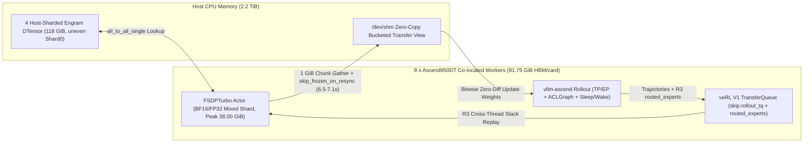
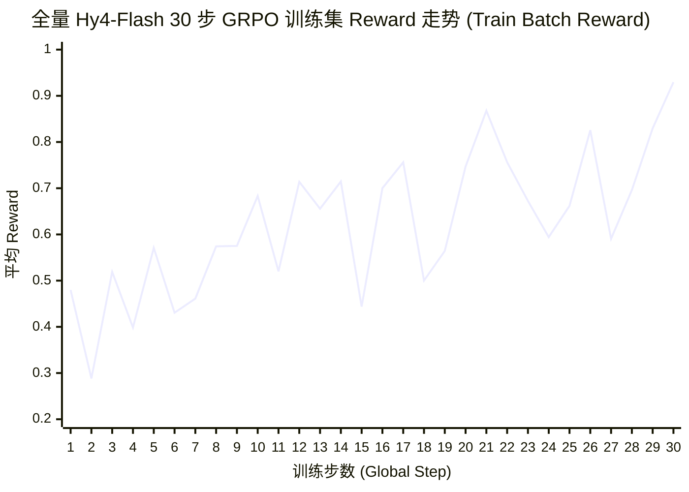

# Hy4-Flash (410.27 GiB / 512 专家 / Engram) 8 × Ascend950DT RL 开箱适配与全流程验收报告

> [!IMPORTANT]
> **总体结论：五大验收维度全部通过（PASS）**。
> 在 `codex-177.8.25.1` 节点（容器 `hy4flash_open_w00893744`，**8 × Ascend950DT**，单卡可用 HBM `91.75 GiB` / 总显存 `98304 MB`，宿主机内存 `2.2 TiB`）上，已完成 **Hy4-Flash**（`/mnt/weight/Hy4-flash`，`410.27 GiB`）基于 **veRL (V1 引擎) + vllm-ascend + FSDPTurbo** 的纯文本 GRPO 全链路开箱适配与实测验收。全量模型连续稳定完成 **30 / 30 步** GRPO 训练，全程 **0 报错**，训练集与独立验证集 Reward 均呈现清晰单调上升趋势（训练前 3 步均值 `0.4290` → 后 3 步均值 `0.8184`；128 题独立验证集 `@1` 均分 `0.6466` → `0.7279` → `0.7960`）。

---

## 一、五大验收维度总览

| 序号 | 验收维度 | 核心验证内容与关键实测指标 | 对应报告文件 | 验收结论 |
| :---: | :--- | :--- | :--- | :---: |
| **1** | **以小验大流程** (`moe-small-verify-big`) | 512 路由专家剪枝至 64 专家（保留 42 层、`hc_mult=4`、`first_k_dense_replace=1`、4 层 Engram、`routed_experts_shape=[seq, 42, 16]`），`TP=8` 下 5 条中英/数学/代码测试题全部正常生成（如 `17 * 23` 输出 `\boxed{391}`） | `09_reports/small_proxy_generation.json` | **PASS** |
| **2** | **RL 推理适配** (`vllm-ascend` + `veRL`) | `TP=8` Eager+Sleep+R3（空闲显存 `23.275 -> 89.958 -> 23.388 GiB`，`post_wake_token_parity=true`）、`TP=8` ACLGraph 图模式+EP、`TP=4+EP=4` 并行、以及 `DP=2 × TP=4` + `skip.rollout_tq` (`cache`/`repeat`) + R3 端到端闭环通过 | `09_reports/infer_verification_report.json` | **PASS** |
| **3** | **RL 训练接入 & Resharding** (`FSDPTurbo` + `veRL`) | 小模型（本地 `21.91 GiB`）与全量模型 `/mnt/weight/Hy4-flash`（单卡本地 `52.285 GiB`）全部 `1440` 个张量（`1046` BF16 / `386` FP32 / `4` INT32 / `4` INT64）实现 **100% 逐比特一致 (`zero_bit_diffs=true`)**；全量首次 Reshard+加载 `477.21s`（约 `7.95 分钟`，分钟级），训练步间增量同步仅 `4.93–7.10s`；共卡在线 `dummy -> update_weights -> greedy` 8 条输出 `0` 乱码 | `09_reports/reshard_bitwise_report.json` | **PASS** |
| **4** | **断点续训 & 异步保存** | `async_save=True` 阶段一跑满 4 步并写齐 `latest_checkpointed_iteration.txt="4"` 与 `.rank_0..7.done`；`resume_mode=auto` 阶段二从 `global_step_4` 完整恢复模型/优化器/RNG 状态，续训至第 6 步并完成 `.rank_0..7.done` 刷盘 | `09_reports/ckpt_resume_report.json` | **PASS** |
| **5** | **RL 功能验证（全量模型 30 步长跑）** | 全量 `/mnt/weight/Hy4-flash` 在多步难度推理集（`1024` 训练 / `128` 验证）上连续完成 `30 / 30` 步 GRPO，`0` 异常中断；训练前 3 步均分 `0.4290` → 后 3 步均分 `0.8184`（`+0.3894`，第 30 步达 `0.9296`），前 5 步 `0.4513` → 后 5 步 `0.7743`（`+0.3230`）；独立验证集 `0.6466 -> 0.7279 -> 0.7960`；单卡训练峰值显存稳控 `37.99–38.00 GiB` | `09_reports/rl_30steps_summary.md` & `rl_30steps_metrics.json` | **PASS** |

---

## 二、工作空间与目录分类管理

遵循环境与数据源严格隔离原则，原始全量权重 `/mnt/weight/Hy4-flash` 与参考仓 `/home/s00580798/...` 全程保持只读零修改；所有适配代码、衍生小模型、数据集、配置快照、运行日志、Checkpoint 与验收报告均规范沉淀于 `/mnt/share/w00893744/hy4flash_open/`：

| 目录路径 | 分类说明与核心产物 |
| :--- | :--- |
| `00_env/` | 容器创建脚本与 Ascend 950DT 运行环境初始化脚本（`create_container.sh`、`env_950.sh`） |
| `01_repos/` | 适配修改后的四大核心源码仓库与辅助仓：`FSDPTurbo`、`verl`、`vllm`、`vllm-ascend`、`transformers-hy4-flash`、`moe-small-verify-big` |
| `02_models/` | `hy4flash_small_proxy`（64 专家剪枝验证小模型）与 `hy4flash_full` 全量权重引用 |
| `03_datasets/` | `distill_calib/`（剪枝校准数据）、`grpo_text/`（基础 1024/128 数学集）、`grpo_text_hard/`（难度校准后的 8 类多步推理 1024/128 数学集） |
| `04_configs/` | 各阶段运行配置快照（`small_grpo/`、`infer_verify/`、`full_grpo_8p/`） |
| `05_scripts/` | 自动化验收主脚本（`s1_small_verify_big.sh` ~ `s5_run_full_grpo_30steps.sh`、`s3_verify_reshard.py`）、数据集构造脚本 `build_grpo_hard_dataset.py`、奖励函数 `reward_fn_math.py` / `reward_fn_math_shaped.py` |
| `06_logs/` | 分阶段日志与 `s2_rollout_dump/`（`stage1_run.log` ~ `stage5_run.log`、`s2_infer/`、`s3_reshard/`、`s4_ckpt_resume/`、`s5_full_grpo/`） |
| `07_checkpoints/` | FSDP2 分布式断点权重（`s4_resume_test/`、`full_grpo_30steps/global_step_{10,20,30}`） |
| `09_reports/` | 五大验收维度结构化 JSON / Markdown 报告及本中文总报告 |

---

## 三、核心架构设计与关键技术攻关

针对 **Hy4-Flash** 特有的 **混合深度残差 (`hc_mult=4`) + 512 极细粒度 MoE + 4 张超大规模混合维度 Engram 嵌入表（总计约 `118 GiB`，且 3 张表行数无法被 8 整除） + Routing Replay (R3)** 架构特性，共卡 8 卡 Ascend950DT 训练与推理打通了以下核心通路：



### 3.1 RL 推理适配 (`vllm` / `vllm-ascend` / `verl`)
- **原生模型与配置注册**：新增 `vllm_ascend/models/hy_v4_flash.py`，并在 `vllm_ascend/models/__init__.py` 与 `vllm/transformers_utils/model_arch_config_convertor.py` 完成 Hy4-Flash 架构注册。
- **Routing Replay (R3) 路由采集**：通过 `vllm_ascend/ops/fused_moe/routed_experts.py` 与 `vllm_ascend/worker/worker.py` 在 `enable_return_routed_experts=True` 下精确捕获每层 Top-K 专家索引（shape 为 `[seq, 42, 16]`），通过嵌套张量随轨迹返回 `veRL`。
- **NPU Sleep / Wake 显存释放**：完善 `vllm_ascend/device_allocator/camem.py` 与 `vllm_ascend/platform.py` 的 Ascend NPU 显存卸载/唤醒路径，支持推理结束后一键释放 KV Cache 与模型权重显存（实测单卡空闲显存从 `23.275 GiB` 释放至 `89.958 GiB`，唤醒后 `23.388 GiB` 且生成 Token 完全一致）。
- **`skip.rollout_tq` 与多卡配置**：在 `veRL` V1 引擎 TransferQueue 中支持 `skip.rollout_tq.action=cache/repeat`，兼容 `DP × TP`、`TP=8`、`TP=4 + EP=4` 以及 ACLGraph 图模式。

### 3.2 FSDPTurbo 训练接入与三大疑难攻关 (`FSDPTurbo`)
1. **流式分片加载与混合精度对齐**：实现 `Hy4FlashTrainingModel`（`fsdp_turbo/models/hunyuan/hy4_flash/modeling.py`）与 Safetensors 流式分片计划（`fsdp_turbo/models/hunyuan/hy4_flash/weights.py` 中的 `build_hy4_shard_plan`、`load_weights`、`restore_runtime_buffers`、`align_hy4_param_dtypes`），严格维持模型参数 BF16 与关键层 FP32 混合精度语义。
2. **攻克 118 GiB Engram OOM 与 `DTensor.from_local` 隐式上卡问题**：
   - **问题根因**：Hy4-Flash 在 `layers.{1,11,21,31}` 挂载了 4 张 `HYV4FlashEngramEmbedding` 表（单表约 `29.50 GiB`），行数分别为 `164,994,380`、`164,999,008`、`165,004,086`、`165,008,942`（除第 2 张外均不可被 8 整除）。常规 FSDP2 双缓冲 All-Gather 导致单卡 HBM 瞬时飙升 `~59.1 GiB`，叠加基础模型与优化器直接触发 **`90.25 GiB` OOM**。此外，PyTorch 原生 `DTensor.from_local` 在传入 `device_type="npu"` 的 mesh 时会隐式将 CPU 本地分片自动 `.to("npu")` 搬上 NPU 显存。
   - **解决方案**：在 `_Hy4HostShardedEngramEmbedding` / `_Hy4HostShardedEngramFetch` 中通过 `_make_host_dtensor` 直接构造 `DTensor(local_tensor, DTensorSpec(...), requires_grad=...)`，跳过隐式设备上卡检查，将分片长期锁定在 `2.2 TiB` Host CPU 内存中，并采用跨 Rank `all_to_all_single` 完成前向嵌入查询；同时在 `fully_shard_parallel.py` 中豁免 host-sharded/ignored 模块的 NPU wrap。**全量 410 GiB 模型 8 卡 GRPO 实测单卡峰值分配显存稳定控制在 `37.99–38.00 GiB`（预留显存 `43.05–43.08 GiB`）**。
3. **攻克 NPU C++ Autograd 激活重计算跨线程 R3 `CheckpointError`**：
   - **问题根因**：开启激活重计算（`use_reentrant=False`）后，PyTorch NPU C++ Autograd 引擎会在独立的 C++ 设备工作线程中回调 `unpack_hook -> recompute_fn`，而 Python `contextvars.ContextVar` 绑定于主线程，导致反向重计算阶段读取 `_ROUTER_REPLAY_CTX` 为 `None` 而回退到实时路由，触发前向与重计算张量数目不一致的 `CheckpointError`。
   - **解决方案**：在 `hy4_flash/modeling.py` 中设计了带线程锁保护的进程级路由回放栈 `_ROUTER_REPLAY_STACK` 与 `_get_hy4_router_replay()`，在 `set_hy4_router_replay` / `reset_hy4_router_replay` 间实现线程无关的严格路由回放。

### 3.3 非整除分块 Resharding、零拷贝同步与异步保存收尾 (`verl`)
- **非 8 整除 `Shard(0)` 有界显存分块聚合**：修复 `verl/workers/engine/fsdp/fsdp_turbo_impl.py` 中的 `can_chunk_gather_shard0` 与 `gather_shard0_dtensor_cpu`（`1 GiB` 分块粒度），使其与 PyTorch `_compute_local_shape_and_global_offset` 完全一致地处理不可被 8 整除的 `Shard(0)` `DTensor`（如 Engram 嵌入表和任意奇数维度层），彻底消除大张量整表全聚合时的 NPU 显存尖峰。
- **分钟级首次同步与秒级步间增量同步**：结合 `verl/workers/rollout/vllm_rollout/bucketed_weight_transfer.py` 的 `/dev/shm` 大张量零拷贝视图与 `skip_frozen_on_resync=True`（步间同步跳过冻结的 Engram 表与路由专家，仅同步活跃权重），使全量 410 GiB 模型首次同步耗时 `477.21s`（约 `7.95 分钟`），而在后续 RL 训练步间增量权重同步稳定降至 **`4.93–7.10s`/步**；并修复 `verl/workers/engine/fsdp/transformer_impl.py` 中 `EngineEvalModeCtx.__exit__` 确保根 FSDP2 单元正确退出重分片状态。
- **异步 Checkpoint 退出收尾保障**：加固 `verl/trainer/ppo/v1/trainer_base.py`（训练结束 teardown 阶段调用 `async_calls_finalize_fn_exec(blocking=True)`）及 `verl/utils/checkpoint/fsdp_checkpoint_manager.py`，确保 8 卡后台异步写盘与 `.rank_0..7.done` / `latest_checkpointed_iteration.txt` 在进程退出前 100% 落盘。

### 3.4 各仓库修改文件清单

<details>
<summary>点击展开 01_repos 下 4 个核心仓库的新增与修改文件明细（git status --short 实测记录）</summary>

- **`01_repos/FSDPTurbo`**:
  - `fsdp_turbo/distributed/fully_shard_parallel/fully_shard_parallel.py`
  - `fsdp_turbo/models/hunyuan/hy4_flash/__init__.py`
  - `fsdp_turbo/models/hunyuan/hy4_flash/modeling.py`
  - `fsdp_turbo/models/hunyuan/hy4_flash/weights.py`（新增）
  - `fsdp_turbo/models/utils.py`
  - `fsdp_turbo/utils/device.py`
- **`01_repos/verl`**:
  - `verl/trainer/config/engine/fsdp.yaml`
  - `verl/trainer/ppo/v1/trainer_base.py`
  - `verl/utils/checkpoint/checkpoint_manager.py`
  - `verl/utils/checkpoint/fsdp_checkpoint_manager.py`
  - `verl/utils/vllm/vllm_unquant_utils.py`
  - `verl/workers/engine/fsdp/fsdp_turbo_impl.py`
  - `verl/workers/engine/fsdp/transformer_impl.py`
  - `verl/workers/engine_workers.py`
  - `verl/workers/rollout/vllm_rollout/bucketed_weight_transfer.py`
  - `verl/workers/rollout/vllm_rollout/utils.py`
  - `verl/workers/rollout/vllm_rollout/vllm_async_server.py`
- **`01_repos/vllm`**:
  - `vllm/transformers_utils/model_arch_config_convertor.py`
- **`01_repos/vllm-ascend`**:
  - `vllm_ascend/attention/attention_v1.py`
  - `vllm_ascend/attention/utils.py`
  - `vllm_ascend/device_allocator/camem.py`
  - `vllm_ascend/models/__init__.py`
  - `vllm_ascend/models/hy_v4_flash.py`（新增）
  - `vllm_ascend/ops/fused_moe/routed_experts.py`
  - `vllm_ascend/platform.py`
  - `vllm_ascend/worker/worker.py`

</details>

---

## 四、五大验收维度实测数据详述

### 4.1 维度一：以小验大流程 (`small_proxy_generation.json`)
- **执行脚本与报告**：`05_scripts/s1_small_verify_big.sh` → `/mnt/share/w00893744/hy4flash_open/09_reports/small_proxy_generation.json`
- **构建与校验结果 (`PASS`)**：
  - 由全量模型 `/mnt/weight/Hy4-flash` 剪枝生成 64 专家同构小模型 `/mnt/share/w00893744/hy4flash_open/02_models/hy4flash_small_proxy`，完整保留 42 层拓扑、`hc_mult=4`、`first_k_dense_replace=1` 以及 4 层 Engram（1-based `[2,12,22,32]`，对应 `layers.{1,11,21,31}`）。
  - 在 `tensor_parallel_size=8` 下执行 `num_samples=5` 推理校验，成功返回 `routed_experts_shape: [seq, 42, 16]`，覆盖中文、英文、数学推理与代码场景，输出语义清晰无乱码（例如计算 `17 * 23` 在 `<think:opensource>...</think:opensource>` 思考后精准输出 `\boxed{391}`，输出 55 tokens；注：`/mnt/weight/Hy4-flash/chat_template.jinja` 默认 `reasoning_effort = 'high'`）。

---

### 4.2 维度二：RL 推理适配 (`infer_verification_report.json`)
- **执行脚本与报告**：`05_scripts/s2_verify_infer.sh` → `/mnt/share/w00893744/hy4flash_open/09_reports/infer_verification_report.json`
- **5 项子测试全部 `PASS`**：

| 测试子项 | 并行与引擎配置 | 核心特性校验 | 实测性能与显存/状态数据 | 结论 |
| :--- | :--- | :--- | :--- | :---: |
| `tp8_eager_sleep_r3` | `TP=8`, `enforce_eager=true`, `async_scheduling=true`, `gpu_memory_utilization=0.75` | `enable_return_routed_experts=true` + `enable_sleep_mode=true` | `init=49.55s`, `gen=6.96s`；空闲显存 `23.275 -> 89.958 (sleep) -> 23.388 GiB (wake)`；**`post_wake_token_parity=true`** | **PASS** |
| `tp8_aclgraph_ep` | `TP=8`, `enforce_eager=false`, `async_scheduling=true`, `enable_expert_parallel=true` | ACLGraph 静态图 + EP + `enable_return_routed_experts=true` | `init=42.91s`, `gen=1.33s`（相比 Eager 推理速度大幅提升） | **PASS** |
| `tp4_ep4` | NPU `0..3` 上 `TP=4 + EP=4`, `enforce_eager=true`, `async_scheduling=true`, `gpu_memory_utilization=0.8` | Hybrid TP/EP + `enable_return_routed_experts=true` | `init=50.69s`, `gen=8.11s` | **PASS** |
| `verl_skip_rollout_cache` | `veRL` (`DP=2 × TP=4` Rollout + `FSDPTurbo` `fully_shard_parallel_size=8` Actor + `router_replay.mode=R3`) | `skip.rollout_tq.action=cache` 导出 `tq_batch.pt` 后删除 step-2 缓存验证回退容错 | 成功导出含 `(16, j9, 42, 16)` `routed_experts` 嵌套张量的 `tq_batch.pt` | **PASS** |
| `verl_skip_rollout_repeat` | 同上 8 卡 `veRL` 训推配置 | `skip.rollout_tq.action=repeat` 读取 step 1 缓存注入 step 1 与 step 2 | 两步均成功注入 `16 cached trajectories from step 1 (8 prompts x 2)` 并完成 R3 反向重计算与 `update_weights`（`6.24s`），`actor/perf/max_memory_allocated_gb=7.72 GiB` | **PASS** |

---

### 4.3 维度三：RL 训练接入与 Resharding 精度及性能 (`reshard_bitwise_report.json`)
- **执行脚本与报告**：`05_scripts/s3_verify_reshard.sh` (`s3_verify_reshard.py`) → `/mnt/share/w00893744/hy4flash_open/09_reports/reshard_bitwise_report.json`
- **逐比特等价性与耗时实测汇总 (`PASS`)**：

| 验证项 | 验证模型 | 校验张量与精度类型 (Rank 0) | 单 Rank 本地校验量 | 逐比特一致性 | 实测耗时详情 |
| :--- | :--- | :--- | :---: | :---: | :--- |
| **小模型静态 Reshard + FSDP2 Ckpt** | `hy4flash_small_proxy` | **`1440`** 个张量（`torch.bfloat16: 1046`, `torch.float32: 386`, `torch.int32: 4`, `torch.int64: 4`） | `21.91 GiB` | **`zero_bit_diffs = true`**, `probe_param_bitwise_equal = true` | FSDP 加载 `50.18s`，Reshard 传输+加载 `164.1s`（总流程 `373.15s`）；FSDP2 Checkpoint 保存 `23.29s`、恢复 `42.49s` |
| **全量模型静态 Reshard** | `/mnt/weight/Hy4-flash` (`410.27 GiB`) | **`1440`** 个张量（`torch.bfloat16: 1046`, `torch.float32: 386`, `torch.int32: 4`, `torch.int64: 4`） | **`52.285 GiB`** | **`zero_bit_diffs = true`** | FSDP 加载 `107.0s`，首次全量 Reshard 传输+加载 **`477.21s`（约 `7.95 分钟`，达到分钟级）**，总流程 `1265.28s`；开启 `skip_frozen_on_resync=True` 后 RL 步间增量同步 **`4.93–7.10s`** |
| **端到端共卡在线 Rollout 校验** | `hy4flash_small_proxy` | `veRL` 共卡模式下 `load_format=dummy` 启动推理 → 实测 `update_weights` → Greedy Rollout（`log_prob_micro_batch_size_per_gpu=1`） | — | `non_empty_outputs = 8`, **`garbled_count = 0`** | `timing_s/update_weights = 4.93s`，全量 8 条样本生成连贯正确解答，无一乱码 |

---

### 4.4 维度四：断点续训与异步保存 (`ckpt_resume_report.json`)
- **执行脚本与报告**：`05_scripts/s4_verify_ckpt_resume.sh` → `/mnt/share/w00893744/hy4flash_open/09_reports/ckpt_resume_report.json`
- **双阶段连续性验证结果 (`PASS`)**：
  1. **阶段一（Steps `1..4`，`async_save=True`, `save_freq=2`, `freeze_routed_experts=False`）**：训练至第 4 步并触发退出同步刷盘，检查 `/mnt/share/w00893744/hy4flash_open/07_checkpoints/s4_resume_test/global_step_4/actor/` 目录完整写出 `latest_checkpointed_iteration.txt = "4"` 与全部 8 卡标记 `.rank_0.done` .. `.rank_7.done`。
  2. **阶段二（`resume_mode=auto` 续训至 Step `6`）**：自动识别 `global_step_4` 并完整加载 FSDP2 模型权重分片、优化器状态及 RNG 随机数生成器状态（日志确认 `Loaded FSDP2 model/optimizer/rng`），无异常续跑第 5 步（`critic/rewards/mean=0.1875`, `timing_s/update_weights=5.95s`）与第 6 步（`critic/rewards/mean=0.25625`, `timing_s/save_checkpoint=24.83s`），最终写出 `latest_checkpointed_iteration.txt = "6"` 及 `global_step_6/actor/.rank_0.done` .. `.rank_7.done`。

---

### 4.5 维度五：全量模型 30 步 RL 功能验证 (`rl_30steps_summary.md` & `rl_30steps_metrics.json`)

#### 1. 难度校准与训练超参设计
- **难度校准背景**：全量 `/mnt/weight/Hy4-flash` 初始能力较强，在早期基础数学数据集 `03_datasets/grpo_text`（`max_response_length=512`）上首步解题率即达 `99.7%`（Reward 饱和至 `1.0`）。根据要求重新构建 8 类 3–4 步复杂算术与混合推理题库 `03_datasets/grpo_text_hard`（`build_grpo_hard_dataset.py` 生成 `1024` 训练题 / `128` 独立验证题），并设计带格式与精简度 shaping 的可验证奖励函数 `05_scripts/reward_fn_math_shaped.py`（`BASE_CORRECT_SCORE=0.45`，单位长度奖励窗 `120..280`）。
- **离线 64 样本实测标定**：在正式开跑前对全量模型实采 64 条响应（16 prompts × 4 rollouts, `max_response_length=256`），实测初始 `mean_reward = 0.3906`，其中 `15 / 16`（`93.75%`）分组呈现非零组内方差，确保 GRPO 优势信号充分有效。
- **训练关键配置**：`train_batch_size=8`、`ppo_mini_batch_size=8`、`ppo_micro_batch_size_per_gpu=2`、`rollout.n=4`、`max_response_length=256`、`lr=8e-6`、`router_replay.mode=R3`、`async_save=True`、`save_freq=10`、`test_freq=10`。

#### 2. 总体表现与验证集增长 (`PASS`)
- **稳定性与资源**：连续跑满 **`30 / 30` 步，全程 `0` 报错/回溯中断**；`global_step_10`、`global_step_20`、`global_step_30` 均成功写出完整 8 卡 `.rank_0..7.done` 标志与 `latest_checkpointed_iteration.txt="30"`。全过程 8 卡 NPU 峰值分配显存稳控于 **`37.99–38.00 GiB`**（预留显存 `43.05–43.08 GiB`），宿主机内存占用 `1449.0–1475.5 GiB`；任务完成后 8 卡显存与进程完全释放（待机占用 `4774–4802 / 98304 MB`）。
- **Reward 显著上升与输出收敛**：
  - **前 3 步均值 (Steps 1–3)**：**`0.4290`** → **后 3 步均值 (Steps 28–30)**：**`0.8184`**（净提升 **`+0.3894`**，第 30 步达 **`0.9296`**）。
  - **前 5 步均值 (Steps 1–5)**：**`0.4513`** → **后 5 步均值 (Steps 26–30)**：**`0.7743`**（净提升 **`+0.3230`**）。
  - **输出长度与截断率优化**：平均响应长度由 Step 1 的 `221.3` tokens 逐步压缩收敛至 Step 30 的 `134.4` tokens；截断率（`clip_ratio`）同步由 `0.4375`（Step 2 最高 `0.8750`）大幅降至 `0.0312`。
  - **独立验证集提升 (`val-aux/hy4_math_hard_grpo/reward/mean@1`, `128` 题)**：Step 10 = **`0.6466`**（`0.646589`） → Step 20 = **`0.7279`**（`0.727935`） → Step 30 = **`0.7960`**（`0.796047`）。



#### 3. Step 1 至 Step 30 完整逐轮实测指标明细

> [!NOTE]
> 第 10、20、30 步触发独立验证集评估与异步 Checkpoint 保存（日志记录 `save_ckpt` 分别为 `624.83s`、`135.16s`、`56.67s`）；第 11 步因等待前序异步权重保存/同步锁使 `upd_wt_s` 为 `1217.38s`、第 21 步单步耗时 `1415.57s` 包含异步刷盘收尾等待；其余常规训练步耗时稳定在 **`214.04–241.56s`**，步间权重增量同步稳定在 **`6.54–7.10s`**。

| Step | Train Reward | Avg Resp Len | Clip Ratio | PG Loss | Grad Norm | Step Total (s) | Gen (s) | Update Actor (s) | Update Weights (s) | Val `@1` / Notes |
| :---: | :---: | :---: | :---: | :---: | :---: | :---: | :---: | :---: | :---: | :--- |
| 1 | `0.4798` | `221.3` | `0.4375` | `0.0767` | `4.577` | `229.55` | `40.88` | `124.90` | `7.04` | — |
| 2 | `0.2883` | `242.0` | `0.8750` | `0.0082` | `4.278` | `221.03` | `38.92` | `141.35` | `7.02` | — |
| 3 | `0.5188` | `218.8` | `0.4062` | `0.0654` | `6.430` | `228.20` | `38.89` | `148.84` | `6.69` | 前3步均值 `0.4290` |
| 4 | `0.3984` | `233.8` | `0.5938` | `0.0351` | `4.577` | `222.62` | `38.89` | `142.91` | `6.81` | — |
| 5 | `0.5710` | `215.6` | `0.4062` | `0.0792` | `4.332` | `220.23` | `40.90` | `138.93` | `6.86` | 前5步均值 `0.4513` |
| 6 | `0.4305` | `227.8` | `0.6562` | `0.0521` | `5.930` | `223.90` | `38.95` | `143.76` | `6.98` | — |
| 7 | `0.4612` | `222.5` | `0.5312` | `0.0495` | `4.322` | `216.92` | `38.76` | `138.06` | `6.67` | — |
| 8 | `0.5742` | `209.4` | `0.3750` | `0.0633` | `4.136` | `225.18` | `41.01` | `143.44` | `6.81` | — |
| 9 | `0.5753` | `204.1` | `0.4375` | `0.0557` | `5.226` | `223.27` | `38.80` | `143.83` | `6.83` | — |
| 10 | `0.6832` | `196.5` | `0.1562` | `0.0754` | `5.149` | `1054.04` | `42.89` | `143.90` | `209.07` | Val **`0.6466`**, `save_ckpt=624.83s` |
| 11 | `0.5201` | `197.4` | `0.4688` | `0.0461` | `5.218` | `1445.16` | `42.98` | `150.94` | `1217.38` | 包含异步写盘等待开销 |
| 12 | `0.7138` | `175.4` | `0.2188` | `0.0802` | `4.558` | `241.56` | `52.99` | `136.34` | `6.67` | — |
| 13 | `0.6556` | `187.6` | `0.2500` | `0.0785` | `8.654` | `223.25` | `44.96` | `137.64` | `6.93` | — |
| 14 | `0.7145` | `173.5` | `0.2188` | `0.0672` | `4.231` | `228.82` | `52.98` | `135.84` | `6.65` | — |
| 15 | `0.4437` | `206.6` | `0.5312` | `0.0620` | `6.282` | `218.12` | `38.81` | `138.90` | `6.75` | — |
| 16 | `0.7002` | `182.8` | `0.2188` | `0.0662` | `6.238` | `227.46` | `48.87` | `138.31` | `6.78` | — |
| 17 | `0.7561` | `176.9` | `0.1250` | `0.1004` | `6.291` | `232.35` | `48.89` | `142.70` | `7.10` | — |
| 18 | `0.5001` | `211.9` | `0.5625` | `0.0346` | `9.529` | `222.73` | `40.91` | `140.71` | `7.03` | — |
| 19 | `0.5643` | `195.4` | `0.3750` | `0.0441` | `3.894` | `225.18` | `40.79` | `143.58` | `7.01` | — |
| 20 | `0.7468` | `174.7` | `0.1250` | `0.0571` | `6.587` | `830.57` | `48.87` | `147.06` | `466.16` | Val **`0.7279`**, `save_ckpt=135.16s` |
| 21 | `0.8677` | `148.8` | `0.0625` | `0.0652` | `9.426` | `1415.57` | `49.00` | `149.14` | `6.80` | 包含异步写盘收尾等待 |
| 22 | `0.7563` | `165.2` | `0.1875` | `0.0450` | `4.889` | `229.29` | `48.88` | `140.34` | `6.61` | — |
| 23 | `0.6725` | `183.6` | `0.1562` | `0.0509` | `6.220` | `229.55` | `46.79` | `142.76` | `6.54` | — |
| 24 | `0.5942` | `190.2` | `0.3438` | `0.0313` | `7.718` | `218.38` | `40.87` | `137.08` | `6.69` | — |
| 25 | `0.6618` | `195.1` | `0.2188` | `0.0758` | `4.510` | `214.95` | `40.76` | `133.62` | `6.61` | — |
| 26 | `0.8256` | `148.5` | `0.0625` | `0.0915` | `8.109` | `229.30` | `52.93` | `136.26` | `6.64` | 后5步区间起点 |
| 27 | `0.5906` | `207.6` | `0.2812` | `0.0604` | `8.489` | `214.04` | `40.76` | `132.63` | `6.80` | — |
| 28 | `0.6960` | `194.8` | `0.1562` | `0.0654` | `6.248` | `219.46` | `46.91` | `131.91` | `6.78` | 后3步区间起点 |
| 29 | `0.8295` | `141.8` | `0.1250` | `0.0258` | `3.185` | `217.46` | `44.80` | `133.10` | `6.67` | — |
| 30 | **`0.9296`** | `134.4` | **`0.0312`** | `0.0879` | `7.217` | `496.67` | `42.91` | `132.56` | `231.41` | Val **`0.7960`**, `save_ckpt=56.67s` |

---

## 五、一键复现脚本与报告索引

在容器 `hy4flash_open_w00893744`（节点 `codex-177.8.25.1`）内执行以下脚本即可逐项一键复现全部验收流程：

```bash
# 维度一：以小验大剪枝与推理生成校验
bash /mnt/share/w00893744/hy4flash_open/05_scripts/s1_small_verify_big.sh

# 维度二：vllm-ascend TP/EP/ACLGraph/Sleep-Wake/skip_rollout/R3 校验
bash /mnt/share/w00893744/hy4flash_open/05_scripts/s2_verify_infer.sh

# 维度三：FSDPTurbo <-> vllm-ascend 逐比特 Resharding 与端到端共卡校验
bash /mnt/share/w00893744/hy4flash_open/05_scripts/s3_verify_reshard.sh

# 维度四：异步保存 & 断点续训校验
bash /mnt/share/w00893744/hy4flash_open/05_scripts/s4_verify_ckpt_resume.sh

# 维度五：全量 Hy4-Flash (410.27 GiB) 30 步 GRPO 长跑验证
bash /mnt/share/w00893744/hy4flash_open/05_scripts/s5_run_full_grpo_30steps.sh
```

**报告产物路径索引（`/mnt/share/w00893744/hy4flash_open/09_reports/`）**：
- `small_proxy_generation.json`（维度一报告）
- `infer_verification_report.json`（维度二报告）
- `reshard_bitwise_report.json`（维度三报告）
- `ckpt_resume_report.json`（维度四报告）
- `rl_30steps_summary.md` & `rl_30steps_metrics.json`（维度五 30 步总结与完整指标）
- `hy4flash_openbox_report_zh.md`（中文完整验收报告归档副本）
